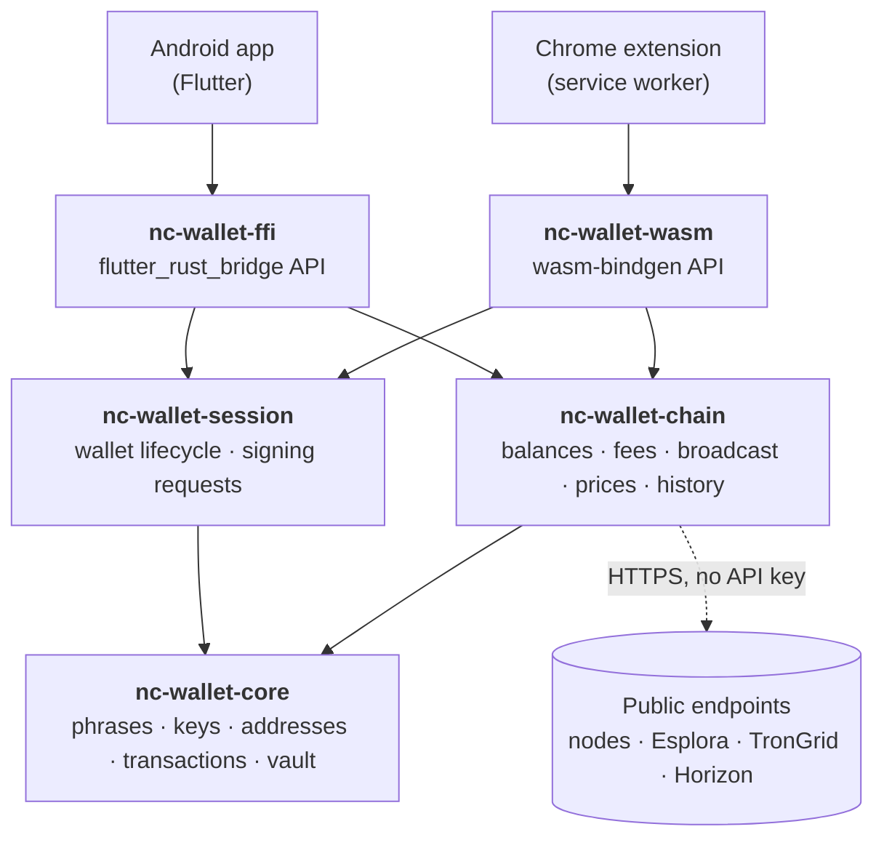

<div align="center">

# Nowcoin Omega · Core Engine

**The self-custody engine behind Nowcoin Omega: keys, addresses, transactions, signing and chain access, in Rust.
No server, no API keys, and the secrets never leave the device.**

[](https://github.com/Nowcoins/omega-core/actions/workflows/ci.yml)
[](LICENSE)
[](rust-toolchain.toml)
[](#building)

</div>

---

Nowcoin Omega is a self-custody wallet for Android and Chrome. This repository is its **engine**: the Rust code that makes
and restores recovery phrases, derives accounts on nine networks, builds and signs transactions, keeps the phrase in an
encrypted vault, and reads balances, fees, prices and history straight from public blockchain endpoints. Both apps run
this same code: the Android app through [`flutter_rust_bridge`](https://github.com/fzyzcjy/flutter_rust_bridge), the
Chrome extension as WebAssembly in its service worker.

The apps' user interfaces are not part of this repository. Everything that touches a key, or decides what is signed, is.

## Contents

- [Principles](#principles)
- [Networks](#networks)
- [Architecture](#architecture)
- [Security model](#security-model)
- [Building](#building)
- [Testing](#testing)
- [Repository layout](#repository-layout)
- [Documentation](#documentation)
- [Reporting a vulnerability](#reporting-a-vulnerability)
- [License](#license)

## Principles

| | |
|---|---|
| **Keys stay in the engine** | A recovery phrase or a private key exists only in Rust (or WebAssembly) memory, wiped when dropped. The apps hold a sealed vault and handles, never a secret. |
| **No server** | There is no Nowcoin backend for the wallet. The engine talks to public, keyless endpoints only (the networks' own nodes, Esplora, TronGrid, Horizon). A test fails if any endpoint is a Nowcoin host. |
| **No single source is trusted** | A fee or a nonce is asked of two different operators and believed where they agree; a third breaks a tie. Every figure also has the wallet's own ceilings. |
| **What you approve is what is signed** | Decoding a request yields the summary the approval screen shows and an approval hash over the exact bytes to be signed. Signing recomputes the hash and refuses on any difference. |
| **No home-made cryptography** | BIP-39, BIP-32, secp256k1, ed25519, sr25519, Argon2id and AES-GCM come from maintained crates. The one hand-written primitive, SLIP-10 (about 20 lines of HMAC-SHA512), is pinned by the specification's own vectors. |
| **Pinned by published vectors** | Derivation and encoding are checked against the BIPs, SLIP-0010, SEP-0005, Trezor's firmware fixtures, Trust Wallet Core, MetaMask's `eth-sig-util`, Polkadot.js, Substrate and real mainnet transactions. Every constant names its source. |

## Networks

| Network | Coins | Account path | Keys and addresses |
|---|---|---|---|
| Ethereum | ETH, USDT, USDC | `m/44'/60'/0'/0/i` | secp256k1, EIP-55 |
| BNB Smart Chain | BNB, USDT, USDC | `m/44'/60'/0'/0/i` | secp256k1, EIP-55 |
| Polygon PoS | POL, USDT0, USDC | `m/44'/60'/0'/0/i` | secp256k1, EIP-55 |
| Base | ETH, USDC | `m/44'/60'/0'/0/i` | secp256k1, EIP-55 |
| TRON | TRX, USDT | `m/44'/195'/0'/0/i` | secp256k1, base58check |
| Bitcoin | BTC | `m/84'/0'/0'/0/i` (change `m/84'/0'/0'/1/i`) | secp256k1, native SegWit (P2WPKH) |
| Solana | SOL, USDT, USDC | `m/44'/501'/i'/0'` | ed25519 (SLIP-10) |
| Stellar | XLM, USDC | `m/44'/148'/i'` | ed25519 (SLIP-10), strkey |
| Bittensor | TAO | root key for `i = 0`, hard junction `//i` after | sr25519, SS58 prefix 42 |

Signing covers legacy (EIP-155) and EIP-1559 transactions, ERC-20 transfers and approvals, `personal_sign` and EIP-712
typed data on the EVM chains; TRX and TRC-20 transfers and `signMessageV2` on TRON; P2WPKH payments with deterministic
coin selection and replace-by-fee on Bitcoin; legacy and version-0 messages and `signMessage` on Solana; payments,
trustlines and account creation on Stellar; and `Balances.transfer_keep_alive` on Bittensor. The full matrix, with the
source of every vector, is in [`crates/nc-wallet-core/README.md`](crates/nc-wallet-core/README.md).

## Architecture



| Crate | What it is | I/O |
|---|---|---|
| [`nc-wallet-core`](crates/nc-wallet-core) | The signing core: BIP-39 phrases, key derivation and addresses for every network, transaction encoding and signing, approval decoding (ERC-20, EIP-712, permits, Solana instructions), and the password vault. | none: no I/O, no async, no threads |
| [`nc-wallet-chain`](crates/nc-wallet-chain) | The chain client: balances, the inputs a send needs, fee estimates, broadcast, prices from on-chain Chainlink feeds, history, and a strict read-only passthrough for dApps, all from public endpoints with quorum, pacing and back-off. | HTTPS through a `Platform`: reqwest + rustls natively, the browser's `fetch` in WebAssembly |
| [`nc-wallet-session`](crates/nc-wallet-session) | The state machine both apps share: making a wallet, the backup quiz, seal-then-commit, the unlocked session, signing requests with their summaries, warnings and approval hashes. | none |
| [`nc-wallet-ffi`](crates/nc-wallet-ffi) | The Android library (`cdylib`): the session and the chain client as a Dart API. | through `nc-wallet-chain` |
| [`nc-wallet-wasm`](crates/nc-wallet-wasm) | The extension's engine as WebAssembly, for its service worker only. | through `nc-wallet-chain`, with the browser's `fetch` |

## Security model

**What is trusted.** The operating system's randomness (`getrandom`; the browser's `crypto.getRandomValues` in
WebAssembly, where the build fails rather than fall back to anything weaker) and the code in this repository.

**What is not.** Every endpoint, every website that asks for a signature, and every number that arrives from outside.

- **Secrets.** `Mnemonic`, `Seed` and `SigningKey` zeroize on drop, print a placeholder under `Debug` and have no
  `Display`; each is read through a method named for it (`expose_phrase`, `expose_secret`), so one search finds every
  reader. Tests check that no formatting of a secret, bare or nested, contains its bytes.
- **The vault.** The phrase (and an optional BIP-39 passphrase) is sealed with **Argon2id** (64 MiB, 3 passes, a random
  16-byte salt) and **AES-256-GCM** (a random 96-bit nonce), the whole header bound as associated data and the payload
  padded so 12- and 24-word phrases make blobs of one length. Hostile cost parameters are refused before anything is
  allocated. The format is documented byte by byte in
  [`crates/nc-wallet-core/src/vault.rs`](crates/nc-wallet-core/src/vault.rs).
- **Approvals.** A request is decoded and checked against the account that would sign, then summarised for the person;
  the approval hash covers the kind, the network, the signer, the exact bytes and the summary. Warnings (an unlimited
  approval, an unknown contract, a mismatched chain...) come from one closed list in the engine, so no app can show a
  request without them.
- **Chain data.** Fees and nonces need two operators to agree, or two of three; a figure from a lone operator is held to
  stricter bounds or refused. A nonce is never taken from the lower of two disagreeing answers. Numbers from the network
  are parsed with overflow checks; recorded hostile answers are part of the test suite.
- **Supply chain.** `crates/nc-wallet-core/tests/dependencies.rs` keeps the secp256k1 stack on `crypto-bigint` 0.7.6 or
  later (RUSTSEC-2026-0387), and [`audit-wallet.sh`](crates/nc-wallet-core/scripts/audit-wallet.sh) audits exactly the
  crates the shipped Android and WebAssembly libraries are built from.

Known limits are listed honestly in [`crates/nc-wallet-core/README.md`](crates/nc-wallet-core/README.md#known-limits).

## Building

The toolchain is pinned in [`rust-toolchain.toml`](rust-toolchain.toml) (Rust 1.98.1, with the `wasm32-unknown-unknown`
target); `rustup` installs it on first use.

```sh
# Everything, natively, with every test
cargo test --workspace

# The browser engine (the profile used for releases: fat LTO, no unwinding)
cargo build -p nc-wallet-wasm --target wasm32-unknown-unknown --profile release-wasm
# then its JavaScript bindings; the CLI must be exactly the crate's version
cargo install wasm-bindgen-cli --version 0.2.129 --locked
wasm-bindgen --target web --out-dir pkg target/wasm32-unknown-unknown/release-wasm/nc_wallet_wasm.wasm

# The Android library (needs the Android NDK and cargo-ndk)
cargo ndk -t arm64-v8a -t armeabi-v7a build -p nc-wallet-ffi --profile wallet-release
```

The Dart side of the bridge is generated with `flutter_rust_bridge_codegen` 2.13.0, the version the crate pins.

## Testing

| What | How |
|---|---|
| Unit, vector and replay tests (no network) | `cargo test --workspace` |
| Lints, as CI runs them | `cargo fmt --all --check` and `cargo clippy --workspace --all-targets -- -D warnings` |
| The engine's tests as WebAssembly, in Node | [`crates/nc-wallet-wasm/scripts/test-wasm.sh`](crates/nc-wallet-wasm/scripts/test-wasm.sh) |
| A vault sealed by one build opens in the other | [`crates/nc-wallet-wasm/scripts/cross-format.sh`](crates/nc-wallet-wasm/scripts/cross-format.sh) |
| The live endpoints, read-only, by hand | `cargo run -p nc-wallet-chain --example live_smoke` (and `--example history_smoke`) |
| The dependency audit of the shipped graph | [`crates/nc-wallet-core/scripts/audit-wallet.sh`](crates/nc-wallet-core/scripts/audit-wallet.sh) (needs `cargo-audit` and `jq`) |

The chain client's tests replay answers recorded from the live endpoints on a clock the test moves, so they are fast,
deterministic and offline. No test ever broadcasts.

## Repository layout

```text
.
├── crates/
│   ├── nc-wallet-core/      signing core: phrases, keys, addresses, transactions, vault
│   │   └── tests/vectors/   published test vectors, each with its source
│   ├── nc-wallet-chain/     chain client: public endpoints, quorum, pacing, history
│   │   ├── examples/        live, read-only smoke checks (run by hand)
│   │   └── tests/fixtures/  recorded endpoint answers, replayed offline
│   ├── nc-wallet-session/   wallet lifecycle and signing requests
│   ├── nc-wallet-ffi/       Android bridge (flutter_rust_bridge)
│   └── nc-wallet-wasm/      browser engine (wasm-bindgen)
├── docs/                    design notes: direct chain access, history
├── Cargo.toml               workspace, shared dependencies, lints and profiles
└── rust-toolchain.toml      the pinned toolchain
```

## Documentation

- [`crates/nc-wallet-core/README.md`](crates/nc-wallet-core/README.md): the signing core in depth (paths, encodings,
  vectors, the vault, dependencies, known limits).
- [`docs/direct-chain.md`](docs/direct-chain.md): how the wallet reads every network itself, endpoint by endpoint.
- [`docs/history.md`](docs/history.md): how a wallet's history is read on the device.
- API reference: `cargo doc --workspace --no-deps --open`.

## Reporting a vulnerability

Please do not open a public issue for a security problem. See [SECURITY.md](SECURITY.md) for how to report one privately.

## License

Licensed under the [Apache License, Version 2.0](LICENSE).
